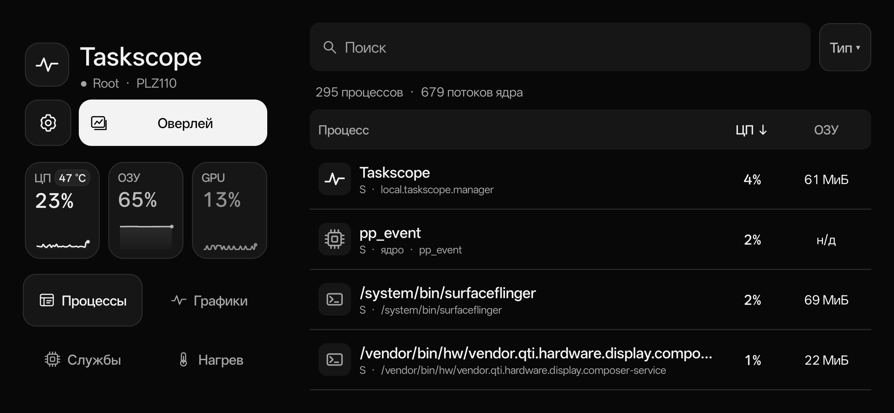
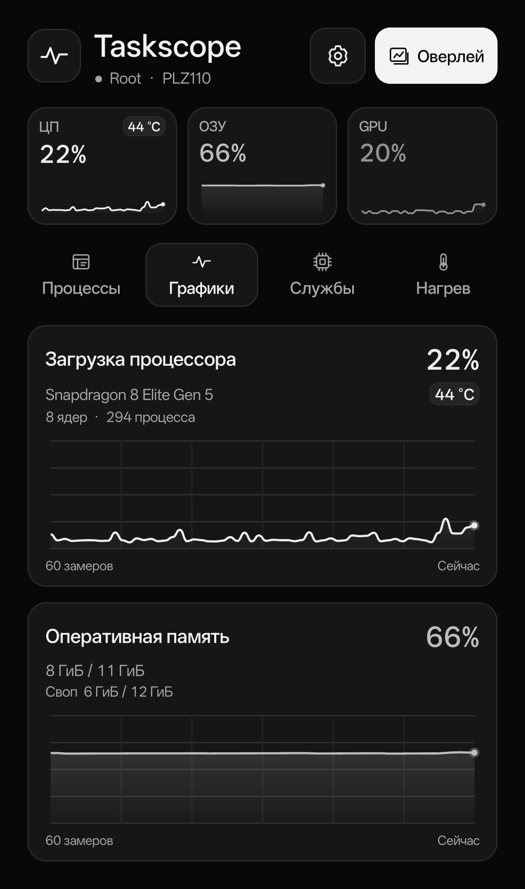
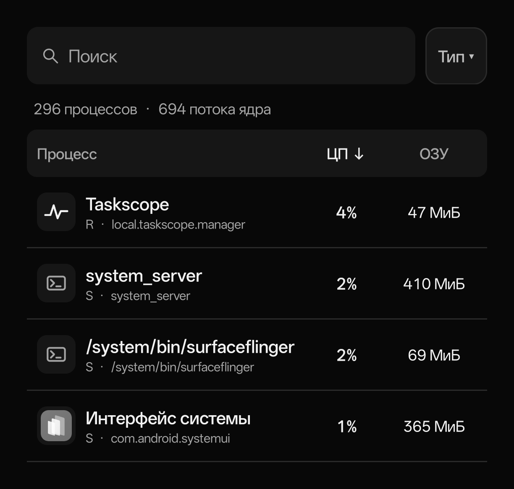
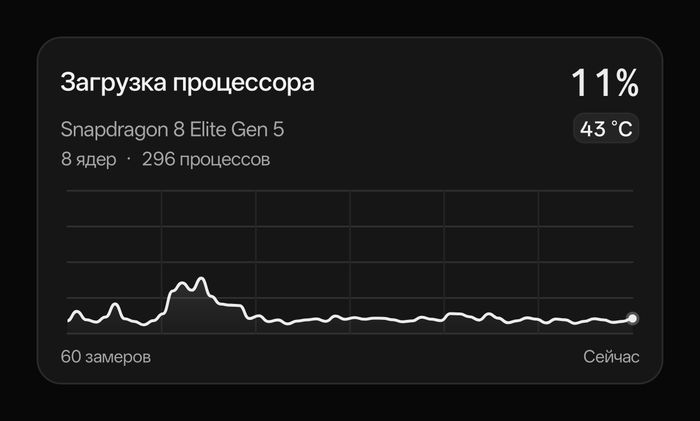
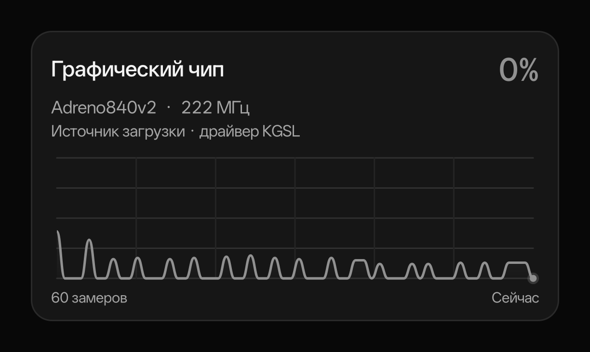
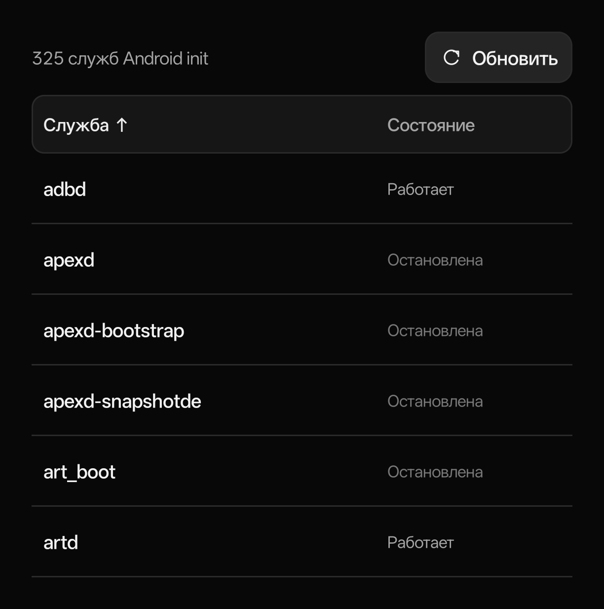
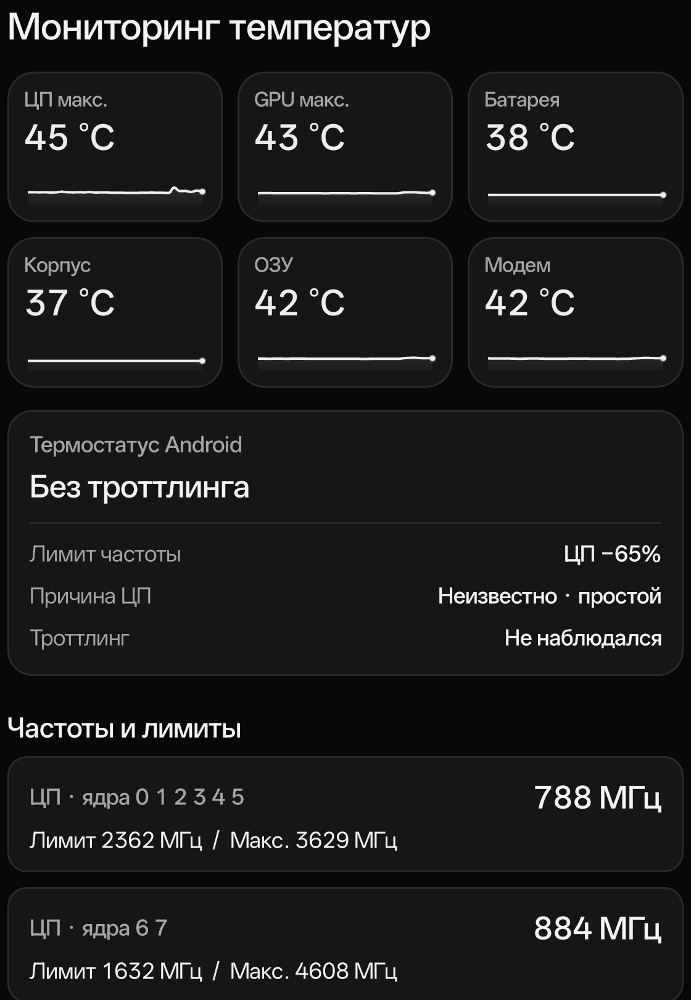
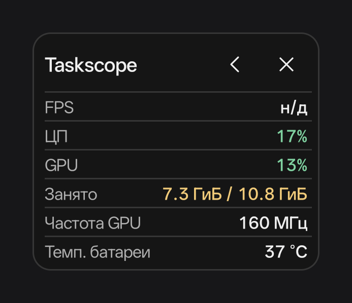

# Taskscope


<p align="center">
  <a href="docs/screenshots/dashboard-landscape.png"></a>
</p>

<p align="center">
  <a href="docs/screenshots/dashboard-portrait.png"></a>
</p>

[Скачать Taskscope 1.0](https://github.com/S3lfuve/Taskscope/releases/tag/v1.0)

Taskscope переносит идею Диспетчера задач Windows на Android с root-доступом. Откройте его, чтобы посмотреть, какие приложения и процессы работают, сколько ресурсов они используют и что можно остановить. Для поиска причин просадок производительности есть графики нагрузки, мониторинг температур и оверлей с FPS поверх игр.

Проект ориентирован прежде всего на OnePlus с ColorOS 15, 16 и 17. Taskscope проверялся на OnePlus 15T с ColorOS 17.

> [!WARNING]
> Для работы Taskscope нужен root-доступ. После установки выдайте приложению права через свой менеджер root.

На других прошивках Android с root-доступом набор показаний зависит от ядра и драйверов. Для GPU Taskscope поддерживает штатные счётчики Adreno (KGSL) и запасные источники Mali, в том числе узлы Exynos. Поддержка One UI на Galaxy Note10+ пока экспериментальная.

## Разделы приложения

### Процессы

В списке видно, как каждый процесс нагружает ЦП и сколько ОЗУ занимает. Есть сортировка по нагрузке и памяти, поиск по имени или PID и отдельные фильтры для приложений, системных процессов и потоков ядра. В настройках можно выбрать способ подсчёта памяти процесса. RSS показывает все резидентные страницы, PSS делит общую память между процессами, USS учитывает только частные страницы. По умолчанию выбран PSS.

В карточке процесса можно посмотреть его состояние и число потоков, приостановить, возобновить или завершить его. Для процесса приложения действие «Завершить» останавливает весь пакет.



### Графики

Здесь видна история загрузки ЦП, GPU и ОЗУ. Для каждого ядра ЦП есть свой график. Нажмите на график, чтобы узнать значение в выбранный момент. После сворачивания Taskscope может собирать данные ещё 1, 3, 5 или 10 минут, пока остаётся в списке недавних приложений.

<p>
  
  
</p>

### Службы

Здесь видны системные службы, которыми управляет Android `init`, и их текущее состояние. Список можно отсортировать по имени или состоянию. Из карточки службы её можно запустить, остановить или перезапустить.



### Нагрев

В этом разделе можно проверить температуры ЦП, GPU и аккумулятора, а при наличии датчиков ещё корпуса, ОЗУ и модема. Текущие частоты и их лимиты помогают заметить, когда система ограничивает производительность. Рядом отображается термостатус Android и причина ограничения частоты ЦП, если её сообщает драйвер.



## Оверлей

Кнопка «Оверлей» открывает плавающее окно поверх игры или другого приложения. Его можно перетащить и свернуть в компактную кнопку. По умолчанию видны FPS, загрузка и температура ЦП и GPU, а также объём занятой ОЗУ. В настройках можно выбрать показатели, изменить их порядок и задать интервал обновления от 250 до 2000 мс.

FPS рассчитывается по времени вывода кадров приложения через Android SurfaceFlinger. Загрузка GPU считывается из счётчика драйвера, когда он доступен. Набор доступных показателей зависит от прошивки, драйвера и датчиков устройства. Если данных для показателя оверлея нет, он отображается как `н/д`.



## Установка

1. Установите APK на устройство.
2. Откройте Taskscope и выдайте ему root-доступ через менеджер root-прав. Это разрешение нужно, чтобы просматривать процессы и службы, управлять ими и получать расширенную телеметрию.
3. Для оверлея разрешите Taskscope показывать окна поверх других приложений в настройках Android.

## Сборка из исходников

В Termux понадобятся `clang`, JDK, `aapt`, `d8`, `apksigner`, `curl` и `unzip`. Запустите скрипт из папки проекта.

```sh
sh build.sh
```

Скрипт скачает Android SDK Platform 35 при первой сборке и создаст подписанный `Taskscope.apk` и файл `release.json` с номером версии из APK. По умолчанию ключ хранится в `.build/local-signing.p12`. Путь к существующему ключу можно передать через `TASKSCOPE_KEYSTORE`. Скрипт запросит пароль или возьмёт его из переменной окружения `TASKSCOPE_KEYSTORE_PASSWORD`.
